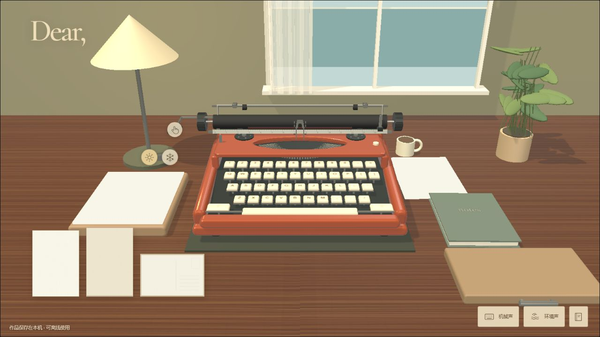

# Dear,

一个复古的在线打字空间。选一张纸，用键盘或鼠标敲下文字，再把它折进信封、收入纸盒，或留在一张明信片上。

**[在线体验 →](https://dear-quiet-typewriter.pages.dev/)**



## 功能

- **两种机器**：手动打字机与字球机；字球机通过取下、安装字球的过场切换字体。
- **三种纸张**：信纸、文学纸与明信片，分别有折信入封、收入纸盒、正反面展示的收纳动画。
- **创作设置**：调整字号、字距、墨色、字符错位与墨色变化；新设置作用于之后打出的字。
- **明信片**：选择自己的照片，搭配动物邮票；导出时将文字面和照片面合成一张图片。
- **声音**：机械打字声与季节环境音分别控制开关和音量。
- **保存与导出**：作品按纸张类型收纳，支持删除、回收站、PNG / PDF 导出，以及 JSON 备份与导入。
- **离线写作**：首次在线加载完成并显示“可离线使用”后，可继续离线使用；更新通过“保存并刷新”手动应用。
- **中英文界面**：打字字符以英文、拉丁字符和标点为主，目前不支持中文正文输入。

## 在本地运行

使用 Node.js **22.12 或以上版本**，推荐 Node.js 24。

```sh
npm ci
npm run dev
```

打开终端显示的本地地址。

```sh
npm test                  # 自动化检查
npm run build             # 常规静态构建，输出 dist/
npm run build:cloudflare  # Cloudflare Pages 构建，输出 dist-cloudflare/
```

Cloudflare 构建包含离线缓存、更新提示、图标和路由回退。发布方法见 [部署说明](deploy/CLOUDFLARE.md)。GitHub 中的检查流程只运行测试和构建，不自动发布网站。

## 数据保存在自己的浏览器

文字、上传的照片和作品记录保存在当前浏览器的 IndexedDB 中，没有作品上传或账号同步服务。清理网站数据、更换设备或更换域名，都可能让原有作品无法在当前页面看到；重要作品请及时导出或备份。

静态资源会进入浏览器的离线缓存。首次离线准备约需下载 14 MB 资源，请等待页面显示“可离线使用”。

## 当前边界

- 桌面浏览器为主要体验；手机和平板的布局适配仍待完善。
- 3D 机构是面向交互的简化模拟，并非特定品牌机器的精密复刻。
- 打印尺寸、移动设备软键盘和不同浏览器的音频行为仍需更多实机校对。

## 项目结构

| 路径 | 内容 |
| --- | --- |
| `src/` | 场景、键盘输入、墨迹、纸张动画、声音、存储与导出 |
| `public/` | 本地字体、音频与动物邮票素材 |
| `test/` | 自动化检查 |
| `scripts/`、`deploy/` | 构建、公开站点检查与离线缓存 |
| `qa*.html` | 开发验收页面，部分页面会在本地浏览器中生成测试作品；不进入生产构建 |

## 素材与许可

项目使用 Three.js、jsPDF，以及 Cormorant Garamond、DM Sans、Courier Prime、Cutive Mono、Special Elite 等字体。音效和环境音来源与许可见 [第三方说明](public/THIRD-PARTY-NOTICES.txt)、[机械声音许可](public/audio/LICENSE.txt) 和 [环境声音许可](public/audio/AMBIENCE-LICENSE.txt)。动物邮票素材为本项目生成。

项目自身暂未指定统一开源许可证。公开仓库用于展示和查看源码；第三方代码、字体与音频遵循各自附带的许可。
